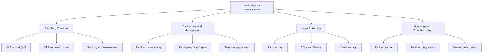
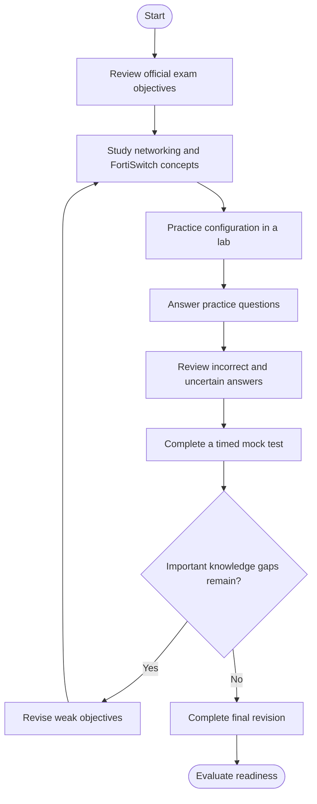
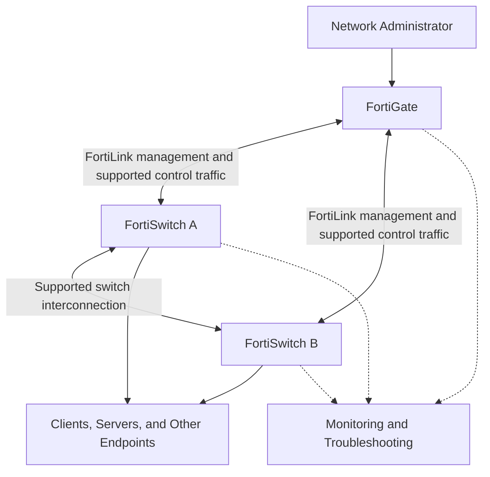
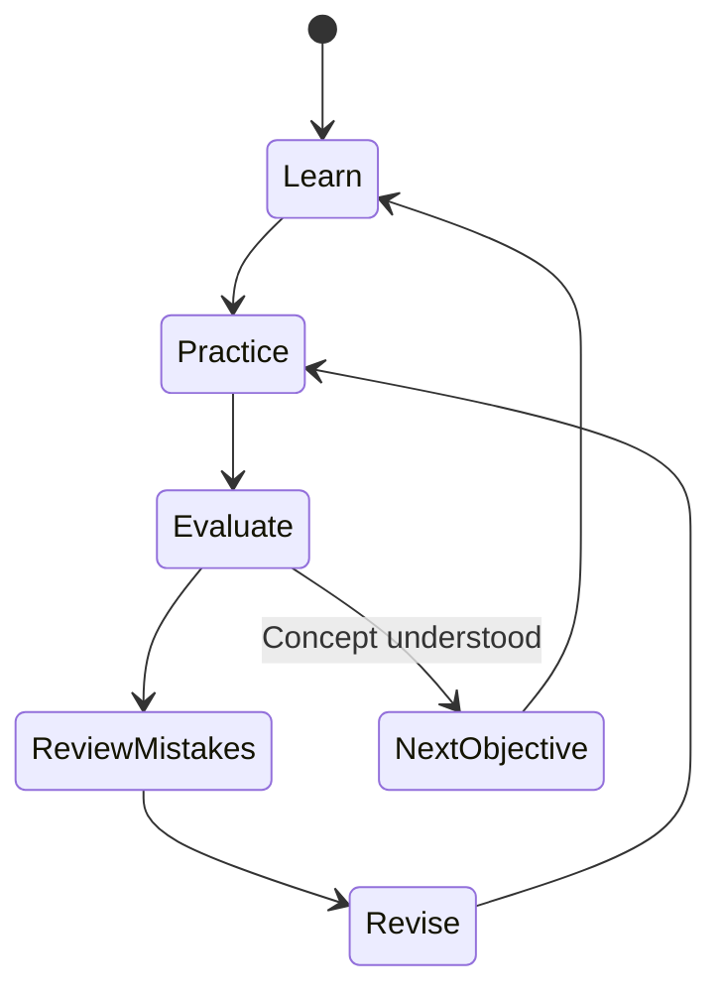
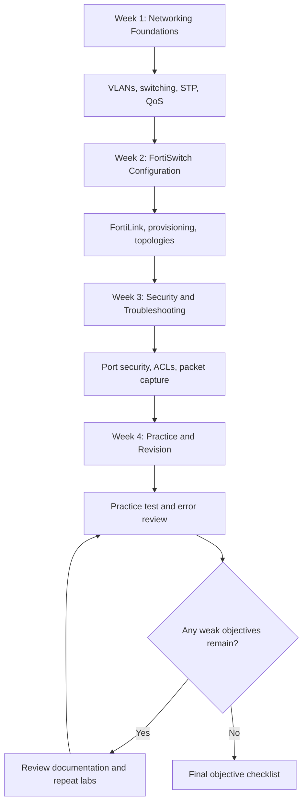

# Fortinet NSE 5 - FortiSwitch 7.6 Administrator Study Guide

A practical study guide for the **Fortinet NSE 5 - FortiSwitch 7.6 Administrator** exam. This repository helps network and security professionals organize their preparation around FortiSwitch configuration, FortiLink provisioning, switching, Layer 2 security, monitoring, and troubleshooting.

The goal is to connect exam objectives with practical networking knowledge. Use the guide alongside Fortinet's official documentation, training, and hands-on exercises. For supplementary review, you can also explore [CertsGate](https://certsgate.com/).

> **Accuracy note:** Fortinet's current exam page lists this exam as *Fortinet NSE 5 - FortiSwitch 7.6 Administrator*. The official exam page is the authority for current availability, requirements, and registration details.

## Table of Contents

- [Overview](#overview)
- [About the Exam](#about-the-exam)
- [Who Should Prepare?](#who-should-prepare)
- [Skills and Knowledge Areas](#skills-and-knowledge-areas)
- [Official Exam Objectives](#official-exam-objectives)
- [Conceptual Skills Map](#conceptual-skills-map)
- [Exam Preparation Flowchart](#exam-preparation-flowchart)
- [FortiSwitch Network Architecture](#fortiswitch-network-architecture)
- [Study and Revision Cycle](#study-and-revision-cycle)
- [Step-by-Step Preparation Guide](#step-by-step-preparation-guide)
- [Suggested Study Roadmap](#suggested-study-roadmap)
- [Practice Questions and Mock Tests](#practice-questions-and-mock-tests)
- [Hands-On Labs](#hands-on-labs)
- [Common Preparation Mistakes](#common-preparation-mistakes)
- [Career Relevance](#career-relevance)
- [Frequently Asked Questions](#frequently-asked-questions)
- [Official Learning Resources](#official-learning-resources)
- [Additional Study Resources](#additional-study-resources)
- [About CertsGate](#about-certsgate)
  

## Overview

FortiSwitch provides network switching capabilities for environments that need reliable connectivity, segmentation, and integration with Fortinet security infrastructure. Depending on the deployment, FortiSwitch devices can be managed through FortiGate using FortiLink or operated in standalone mode.

Preparing for this exam means understanding how these deployment choices affect configuration and day-to-day operations. You should be comfortable with VLANs, switch ports, spanning tree, access controls, monitoring, and troubleshooting—not just the names of individual features.

This FortiSwitch 7.6 Administrator study guide organizes those subjects into a practical learning path, with diagrams, lab ideas, and original review questions.

## About the Exam

The official Fortinet Training Institute currently lists the following exam details.

| Exam detail | Official information |
|---|---|
| Exam name | Fortinet NSE 5 - FortiSwitch 7.6 Administrator |
| Certification provider | Fortinet |
| Product versions | FortiSwitchOS 7.6 and FortiOS 7.6 |
| Exam duration | 70 minutes |
| Number of questions | 35–40 |
| Scoring | Pass or fail; a score report is available through Pearson VUE |
| Languages | English and Japanese |
| Recommended experience | At least six months of hands-on experience with FortiSwitch devices deployed in a network |

Official source: [FortiSwitch Administrator Exam — Fortinet Training Institute](https://training.fortinet.com/local/staticpage/view.php?page=fortiswitch_administrator_exam)

Exam information can change. Confirm the details on Fortinet's official page before scheduling your exam.

## Who Should Prepare?

This guide is intended for:

- Network administrators managing enterprise switching infrastructure.
- Security professionals responsible for secure network access.
- Engineers deploying FortiSwitch devices through FortiGate and FortiLink.
- IT professionals who troubleshoot VLAN, port, and Layer 2 connectivity issues.
- Network engineers learning FortiSwitch standalone operation.
- Candidates seeking to validate their FortiSwitch 7.6 administration skills.

Fortinet's official training course recommends basic networking knowledge, an understanding of Layer 2 switching, and familiarity with FortiGate 7.6 Administrator topics.

If VLANs, trunking, MAC address learning, or spanning tree are unfamiliar, review those fundamentals before moving into advanced FortiSwitch configuration.

## Skills and Knowledge Areas

The official exam objectives are organized into four major areas.

| Area | Practical skills to develop |
|---|---|
| FortiSwitch concepts | VLANs, QoS, LLDP-MED, stack ports, switching and routing, STP, switch ports, split ports, and transceivers |
| Deployment and management | FortiSwitch provisioning, FortiLink deployment topologies, and multi-tenancy |
| Layer 2 control and security | Port security, filtering, antispoofing, ACLs, security profiles, and VLAN security |
| Monitoring and troubleshooting | Packet capture, FortiLink troubleshooting, and extracting network information from FortiSwitch |

These are official topic categories with practical study suggestions added for learning. Fortinet does not publish numerical percentages for these four categories on the referenced exam page, so this guide does not assign invented domain weights.

## Official Exam Objectives

Use this checklist to track your preparation against the published objectives.

### 1. FortiSwitch concepts

- [ ] Configure VLANs using FortiSwitch.
- [ ] Understand and use QoS and LLDP-MED.
- [ ] Configure ports required for stack deployment.
- [ ] Configure switching and routing.
- [ ] Configure STP to prevent network loops.
- [ ] Understand switch ports, split ports, and supported transceivers.

### 2. Deployment and management

- [ ] Configure and provision FortiSwitch.
- [ ] Understand supported deployment topologies.
- [ ] Deploy and configure FortiSwitch in a multi-tenancy environment.
- [ ] Explain the role of FortiLink in managed deployments.
- [ ] Understand the differences between managed and standalone operation.

The final two checklist items are study prompts that support the official deployment objectives.

### 3. Layer 2 control and security

- [ ] Use FortiSwitch port security options.
- [ ] Understand filtering and antispoofing techniques.
- [ ] Configure and interpret ACLs.
- [ ] Understand security profiles and VLAN security mechanisms.

### 4. Monitoring and troubleshooting

- [ ] Use packet capture to investigate traffic problems.
- [ ] Troubleshoot FortiLink issues.
- [ ] Use available tools to view and extract network information from FortiSwitch.
- [ ] Distinguish configuration problems from physical connectivity or topology problems.

**Official objective reference:** [FortiSwitch 7.6 Administrator Exam](https://training.fortinet.com/local/staticpage/view.php?page=fortiswitch_administrator_exam)

## Conceptual Skills Map

The following diagram groups related topics to help plan revision. It is an independent study map, **not an official exam-weighting chart**.

Use the map to identify dependencies. For example, troubleshooting a VLAN connectivity issue is easier when you understand port membership, tagging, the topology, and the relevant security controls.

## Exam Preparation Flowchart

Follow a repeatable process rather than jumping between unrelated topics.

The decision point matters. If you repeatedly miss questions about STP, for example, revisit the underlying switching behavior and test it in a lab before attempting more questions.

## FortiSwitch Network Architecture

This is a simplified conceptual diagram of a FortiLink-managed deployment. Actual supported topologies depend on the product versions, device capabilities, and configuration.

### What to understand in this architecture

**FortiGate:** In a FortiLink-managed topology, FortiGate provides the management relationship used to configure and administer supported FortiSwitch devices.

**FortiSwitch:** Switches connect network endpoints and apply the configured switching behavior, including VLAN and port settings.

**FortiLink:** Learn how FortiLink is established, how provisioning works, and how to investigate failures in the management connection.

**Endpoints:** Client and server connectivity depends on correct physical connections, VLAN membership, port configuration, and any relevant security controls.

**Monitoring:** Troubleshooting should use available device information and packet-capture methods to test a specific hypothesis rather than relying on assumptions.

This illustration is intended for learning. It is not a complete reference architecture or a claim that every deployment must use two switches.

## Study and Revision Cycle

Preparation works best when learning, configuration, evaluation, and correction are repeated.

Apply this cycle to each major objective:

1. Read the relevant official documentation.
2. Explain the concept in your own words.
3. Configure or inspect it in a lab where possible.
4. Test your understanding with questions.
5. Record incorrect assumptions and missing steps.
6. Revisit the documentation and repeat the task.

## Step-by-Step Preparation Guide

### Step 1: Review Layer 2 fundamentals

Before working through product-specific tasks, make sure you understand:

- Access ports and trunk links.
- VLAN tagging and segmentation.
- MAC address learning and forwarding.
- Switching loops and spanning tree.
- Link aggregation concepts.
- Basic IP addressing and routing.
- Physical interfaces, cables, and transceivers.

You do not need to study every networking technology in equal depth. Focus on fundamentals that help you understand the published FortiSwitch objectives.

### Step 2: Learn FortiSwitch management and provisioning

Study the differences between FortiLink-managed and standalone FortiSwitch operation.

For managed deployments, understand the relationship between FortiGate and FortiSwitch, the provisioning process, and the effect of management connectivity problems. For standalone operation, understand which tasks are managed directly and which tools or interfaces are available in your environment.

Practice explaining why a device might not be discovered, provisioned, or managed as expected.

### Step 3: Practice VLANs and switching

Build a small test topology with two VLANs if your lab supports it.

- Assign ports to the intended VLANs.
- Verify tagging and untagged traffic behavior.
- Test permitted and blocked connectivity.
- Review the relevant switch configuration.
- Investigate what changes when a port or VLAN is configured incorrectly.

The goal is to understand the path a frame takes and where a configuration error could interrupt it.

### Step 4: Understand STP, stacking, and port features

Learn how STP helps prevent Layer 2 loops and how to recognize symptoms of switching problems. Review the supported FortiSwitch stacking concepts and the port requirements for the deployment you are studying.

Also study QoS, LLDP-MED, split ports, and supported transceivers. Be able to identify the purpose of each feature and the situations in which it becomes relevant.

### Step 5: Study Layer 2 security

Work through port security, ACLs, filtering, antispoofing, and VLAN security mechanisms.

For each control, ask:

- What traffic or behavior is it intended to control?
- Where is the control applied?
- What evidence would show that it is working?
- How could an incorrect rule affect legitimate traffic?
- What should you check before changing a production configuration?

This approach develops troubleshooting judgment as well as configuration knowledge.

### Step 6: Practice monitoring and troubleshooting

Troubleshooting is easier when you work from the simplest evidence toward more complex explanations.

For a connectivity problem, check the physical link, port state, VLAN configuration, tagging, topology, and applicable security controls. For a FortiLink problem, investigate the relevant management connectivity and device state.

Use packet capture where appropriate to validate what is actually happening. Record your hypothesis, the test you performed, and the result.

### Step 7: Consolidate your knowledge

Once you have reviewed all four official areas, use practice questions and timed mock tests to find remaining gaps. Return to the relevant objective whenever an answer depends on a concept you cannot explain confidently.

## Suggested Study Roadmap

This four-week plan is an **independent recommendation**, not an official Fortinet timetable. Adapt it to your existing networking experience and lab access.

| Week | Focus | Suggested outcome |
|---|---|---|
| 1 | Layer 2 fundamentals and FortiSwitch concepts | Explain VLANs, STP, QoS, ports, and related concepts |
| 2 | Deployment, FortiLink, and management | Describe supported deployment choices and basic provisioning |
| 3 | Layer 2 security and troubleshooting | Investigate configuration issues and understand relevant controls |
| 4 | Practice questions, timed review, and weak areas | Explain answers and identify any objectives that need further work |

A consistent schedule with hands-on repetition is usually more useful than trying to memorize every feature in one sitting.

## Practice Questions and Mock Tests

Practice questions help identify gaps, but they should not replace official documentation or configuration practice.

Fortinet provides sample questions through its training resources. The official exam page notes that sample questions represent the exam's question types and content scope, but do not necessarily cover every topic or determine readiness.

You can also explore independent study materials at [CertsGate](https://certsgate.com/). Use third-party practice questions as supplementary learning aids and verify product-specific details with official documentation.

### Original review questions

The following questions are original educational examples for this repository. They are not official Fortinet exam questions and do not reproduce live exam content.

**Question 1: VLAN connectivity**

Two endpoints on different switch ports cannot communicate as expected. What is a sensible first step?

A. Replace the switch immediately.  
B. Verify the port states, VLAN membership, tagging, and intended traffic path.  
C. Disable every security control.  
D. Change the device hostname.

**Answer: B.** Check the basic forwarding path and configuration before making broad changes.

**Question 2: Spanning tree**

What is the primary purpose of STP in a Layer 2 network?

A. Assign IP addresses to all endpoints.  
B. Prevent Layer 2 switching loops by controlling redundant paths.  
C. Encrypt all switch traffic.  
D. Replace VLAN configuration.

**Answer: B.** STP helps prevent loops in topologies with redundant Layer 2 links.

**Question 3: FortiLink management**

A FortiSwitch is not being managed as expected in a FortiLink deployment. What should you investigate first?

A. The administrator's desktop background.  
B. The relevant FortiLink connectivity, device state, and supported topology.  
C. An unrelated report configuration.  
D. Every VLAN in the network at once.

**Answer: B.** Verify the management path and device state before changing unrelated configuration.

**Question 4: Layer 2 security**

Why might an administrator configure port security or an ACL?

A. To control or restrict network access according to supported rules.  
B. To guarantee that no troubleshooting is needed.  
C. To remove the need for VLANs.  
D. To make every port forward all traffic.

**Answer: A.** These controls help enforce access and traffic restrictions when correctly configured.

**Question 5: Packet capture**

Why is packet capture useful when troubleshooting a network problem?

A. It automatically repairs every configuration error.  
B. It provides evidence about observed traffic that can help validate a troubleshooting hypothesis.  
C. It replaces all device logs and configuration checks.  
D. It guarantees a particular root cause.

**Answer: B.** Packet capture helps you inspect traffic and test explanations, but it must be interpreted in context.

### How to review practice questions

After answering a question:

1. Explain why the correct option is appropriate.
2. Identify why the other options do not fit the scenario.
3. Map the question to an official exam objective.
4. Confirm the concept in the relevant documentation.
5. Repeat the task in a lab when possible.
6. Revisit the topic later to check whether you can reason through it independently.

A mock-test score is only one indicator. You should also be able to explain configurations, interpret evidence, and troubleshoot common scenarios.

## Hands-On Labs

Use an authorized FortiSwitch environment, Fortinet training labs, or a suitable test topology. Exact commands and interface options can vary with software version and deployment mode, so follow the FortiSwitchOS 7.6 documentation.

### Lab 1: VLAN segmentation

**Objective:** Understand how VLAN configuration affects endpoint connectivity.

Tasks:

- Create or inspect a small topology with two VLANs.
- Assign ports to the intended VLANs.
- Verify tagging and connectivity.
- Introduce a safe test misconfiguration.
- Diagnose the issue and document the correction.

**Deliverable:** A VLAN configuration and troubleshooting checklist.

### Lab 2: FortiLink provisioning

**Objective:** Understand the managed-switch workflow.

Tasks:

- Review the supported FortiLink topology for your environment.
- Inspect the relevant FortiGate and FortiSwitch management state.
- Document the expected provisioning process.
- Identify checks to perform when a switch is not discovered or managed.
- Explain the difference between a management problem and an endpoint connectivity problem.

**Deliverable:** A FortiLink troubleshooting flow.

### Lab 3: STP and redundant paths

**Objective:** Understand the purpose of loop prevention.

Tasks:

- Study a supported redundant Layer 2 topology.
- Identify where loops could form.
- Review the relevant STP configuration and operational state.
- Examine how the topology responds to a link-state change if the lab permits.
- Document the evidence you would use to investigate unexpected behavior.

Do not introduce a switching loop into a production network.

### Lab 4: Layer 2 security controls

**Objective:** Understand how port security and ACLs affect traffic.

Tasks:

- Review a supported security configuration in a test environment.
- Identify the traffic or access behavior the control is intended to restrict.
- Test permitted and blocked traffic safely.
- Inspect the resulting behavior.
- Record how you would distinguish an intentional block from an unintended connectivity issue.

**Deliverable:** A security-control verification checklist.

### Lab 5: Packet capture and fault isolation

**Objective:** Practice evidence-based troubleshooting.

Tasks:

- Define a specific connectivity problem in your test environment.
- Check physical link and port status.
- Review VLAN and relevant security settings.
- Use supported packet-capture tools to observe traffic.
- Compare the capture with your original hypothesis.
- Write a short root-cause analysis.

**Deliverable:** A troubleshooting note containing the symptoms, tests, evidence, and conclusion.

## Common Preparation Mistakes

### Memorizing feature names without understanding their purpose

Know what VLANs, STP, ACLs, QoS, and FortiLink do, but also understand how they affect traffic and management.

### Ignoring standalone mode

The official exam description explicitly includes FortiSwitch deployed in standalone mode. Do not study only FortiLink-managed deployments.

### Skipping troubleshooting practice

Being able to configure a feature is not the same as identifying why it is not working. Practice interpreting device state, configuration, and packet-capture evidence.

### Treating all connectivity issues as firewall problems

Switching problems may originate from port state, VLAN membership, tagging, loops, physical links, or Layer 2 security settings. Verify the relevant network path systematically.

### Using outdated documentation

The exam is associated with FortiSwitchOS 7.6 and FortiOS 7.6. Prefer documentation for these versions and verify any differences when using another release.

### Relying only on mock tests

Practice questions can reveal weak areas, but practical configuration and troubleshooting help turn recognition into applied understanding.

## Career Relevance

FortiSwitch administration skills can support work in network operations, enterprise switching, network security, and infrastructure troubleshooting.

Preparation may help you develop the ability to:

- Deploy and manage supported FortiSwitch topologies.
- Configure VLANs and switch ports.
- Understand loop prevention and redundant links.
- Apply Layer 2 access controls.
- Investigate connectivity and FortiLink issues.
- Use packet capture and device information to diagnose network behavior.

The value of certification depends on your broader experience, practical skills, and professional goals. Passing an exam does not guarantee employment or a specific career outcome.

## Frequently Asked Questions

### What is the FortiSwitch 7.6 Administrator exam?

It is a Fortinet exam covering FortiSwitch concepts, deployment and management, Layer 2 control and security, and monitoring and troubleshooting.

### How long is the exam?

The current official exam page lists 70 minutes and 35–40 questions. Confirm the details on the official page before registering.

### Which software versions does the exam cover?

The official exam page lists FortiSwitchOS 7.6 and FortiOS 7.6.

### Does the exam cover FortiLink?

Yes. FortiSwitch provisioning, supported deployment topologies, and FortiLink troubleshooting are included in the published objectives.

### Does it cover standalone FortiSwitch operation?

Yes. The official description states that the exam also tests knowledge of FortiSwitch deployed in standalone mode.

### Are official domain weight percentages available?

The official exam page lists four topic areas but does not provide numerical weight percentages for them. This guide therefore does not invent percentages or assume equal weighting.

### How much experience is recommended?

Fortinet recommends a minimum of six months of hands-on experience with FortiSwitch devices deployed in a network.

### Are the questions in this README official?

No. The review questions are original educational examples written for this repository. They are not official Fortinet questions and are not intended to reproduce the live exam.

### Can CertsGate replace official Fortinet training?

No. CertsGate may be useful as an independent supplementary study resource. Official objectives, Fortinet documentation, and hands-on practice should remain the foundation of preparation.

### How can I assess readiness?

Review every official objective, perform practical tasks where possible, and use practice questions to identify remaining gaps. You should be able to explain your reasoning and troubleshoot common scenarios without depending entirely on memorized answers.

## Official Learning Resources

Use the official Fortinet resources below as your primary references.

- **[FortiSwitch Administrator Exam](https://training.fortinet.com/local/staticpage/view.php?page=fortiswitch_administrator_exam)** — exam details, published objectives, recommended experience, and training resources.
- **[FortiSwitch Administrator Course](https://training.fortinet.com/local/staticpage/view.php?page=library_fortiswitch-administrator)** — course information covering deployment, FortiLink, Layer 2 and Layer 3 features, stacking, and standalone operation.
- **[Fortinet Training Institute](https://training.fortinet.com/)** — official training and certification information.
- **[Fortinet Documentation Library](https://docs.fortinet.com/)** — locate the FortiSwitchOS 7.6 Administration Guide, FortiLink Guide 7.6, and FortiSwitchOS 7.6 CLI Reference.
- **[Pearson VUE](https://home.pearsonvue.com/)** — consult the official exam page for the applicable registration and scheduling route.

Always check that the material you use matches the software version and deployment mode relevant to your preparation.

## Additional Study Resources

Alongside official documentation and labs, independent study resources can provide extra opportunities to review concepts and test your understanding.

[CertsGate](https://certsgate.com/) is an independent IT certification preparation resource. Relevant study guides and practice materials may complement your preparation, particularly when used to identify weak areas and revisit concepts.

For best results, use a consistent sequence:

1. Review an official objective.
2. Study the related documentation.
3. Configure or inspect the feature.
4. Answer practice questions.
5. Analyze incorrect answers.
6. Revisit the objective and repeat the exercise.

## About CertsGate

[CertsGate](https://certsgate.com/) provides independent IT certification preparation materials. These can be used as supplementary learning aids alongside official Fortinet training, version-matched documentation, and practical networking exercises.

CertsGate is not presented here as an official Fortinet certification provider or partner.

